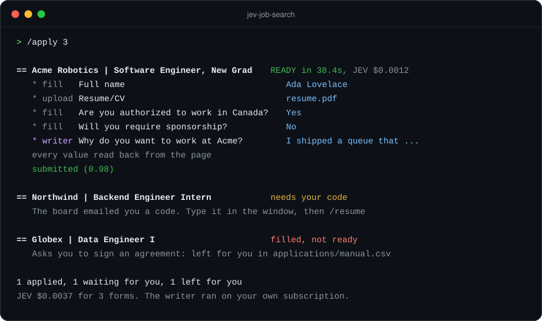
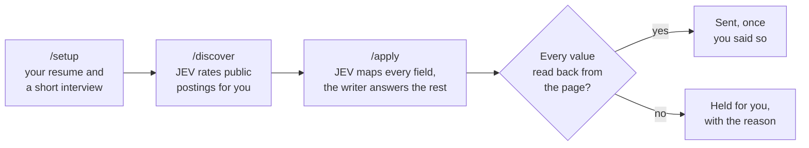

<div align="center">


# jev-job-search

**The job search that fills the forms for you.**

Finds the roles, fills each application in a Chrome window you can watch,<br>
reads every answer back from the page, and sends only what you approve.

[](https://github.com/qbeka/jev-job-search/actions/workflows/ci.yml)
[](https://github.com/qbeka/jev-job-search/releases)
[](LICENSE)


[Quick start](#quick-start) · [How it works](#how-it-works) · [Commands](#commands) · [What it will not do](#what-it-will-not-do) · [Cost](#what-it-costs) · [Docs](#docs)

</div>

<p align="center">
  
</p>
<p align="center"><sub>An illustration of what a run prints. The companies are made up; the person is the one in <code>data/profile.example.json</code>.</sub></p>

## What this is

An open-source job application tool for students and new graduates applying to software roles in Canada, the United States or remotely. You talk to it through a coding agent ([Claude Code](https://claude.com/claude-code) by default, Codex if you prefer), and it does the paperwork:

- **`/discover`** reads public job lists and company boards and ranks what fits you.
- **`/apply`** fills each form in its own Chrome window, checks every answer on the page, and sends the ones you approve.
- **`/report`** opens a dashboard on your own machine with everything that was sent and everything that needs you.

Two models share the thinking. [JEV](https://openrouter.ai/typesafe/jev-1.13) makes every decision that has a fixed set of answers (which of your details goes in this box, which option, how good a fit this job is) for a fraction of a cent. A writer, Claude on your own subscription unless you pick another, writes the sentences. The code does the rest.

> This is an independent open-source project. It is not affiliated with, endorsed by or maintained by Anthropic, OpenAI, TypeSafe, OpenRouter, or any job board. There is no token, coin or paid tier; the only ways to support it are using it and contributing on GitHub.

## Does it actually work?

It is how I run my own search. I sent 100 applications in less than 10 minutes across Ashby, Lever, Workable, Rippling, BambooHR, Jobvite and JazzHR forms, for about a dollar in JEV, while fixing what it got wrong on each new kind of form. Every answer on every one of those forms was read back from the page before it was sent, and every form it could not finish truthfully is in `applications/manual.csv` with the reason. The numbers it reports about itself are in [How well it works](docs/USAGE.md#how-well-it-works). I will add what came of the applications once I know.

It is a beta. Forms on boards it has not met will hold, and it says so.

## Why it is different

- **Nothing is trusted until it is read back.** Every value is read from the page after it is written. A wrong dropdown pick, a date a masked box mangled, or a value a site quietly dropped is caught before Submit, not after.
- **What goes on a form comes from your profile.** Your right to work is worked out in code, per country. Dates and education are copied. A written answer that names a number, a tool or a company your profile does not is refused.
- **Decisions and sentences are split.** JEV returns probabilities, not text, in about half a second. The writer only writes. A form with no open question never calls the writer at all.
- **What it cannot finish truthfully, it sets aside.** A signature, an NDA, a robot check and an emailed code are yours. The form is left open or listed for you with the reason, and the run moves on.
- **It never sends twice, and never unless you asked.** Sending needs your yes. A click with no confirmation is settled before that job is touched again.
- **It learns per site.** How each board's controls take values is noted after every form, read before the next, and shared through the repo.
- **Your data stays yours.** Everything about you lives in git-ignored files on your machine. Passwords live in your system's own secret store and are never shown to a model.

## Quick start

You need [Node.js](https://nodejs.org) 22 or newer, Google Chrome, a coding agent, and a JEV key with a few dollars of credit, from [TypeSafe](https://console.typesafe.ai/keys) or [OpenRouter](https://openrouter.ai/keys) (same model, same price).

```bash
git clone https://github.com/qbeka/jev-job-search
cd jev-job-search
npm install
```

Then open your agent in the folder and ask for the setup:

```bash
claude      # then type: /setup
```

`/setup` checks what is installed, reads your resume PDF and anything else you drop into `documents/`, asks only what those do not say, opens `.env` for you to paste your JEV key (TypeSafe or OpenRouter), builds your profile, finds jobs, rehearses three forms without sending so you can correct what it got wrong, and ends with one real application filled and waiting for your yes. About 20 minutes, most of it your answers.

After that, the whole workflow is three commands:

```
/discover                                        find and rank jobs
/apply                                           fill, check and send the best ones
/apply https://jobs.ashbyhq.com/company/job-id   one posting you found yourself
```

> [!IMPORTANT]
> Everything about you stays in git-ignored files (`data/`, `documents/`, `applications/`, `.env`), so your own clone can be pushed anywhere without leaking anything. Fork only to contribute.

<details>
<summary><b>Using Codex or another agent instead of Claude Code</b></summary>

<br>

`AGENTS.md` gives Codex, Cursor, Gemini CLI and other agents the same rules and the same skills. In Codex the skills are found under `.agents/skills`: type `$setup`, `$discover`, `$apply`, or `/skills` to list them. With any other agent, say what you want ("set this up", "find jobs", "apply to the best five") and it follows the same files.

The agent that runs the skills and the model that writes your answers are two separate choices. To write with something other than Claude, see [Works with](#works-with).

</details>

## Works with

| | |
|---|---|
| **Systems** | macOS, Linux and Windows. Linux and Windows are new: every test runs on all three in CI, with a real browser and each system's real secret store, but a full run on a Linux or Windows desktop has not been done by the maintainer yet. [docs/PLATFORMS.md](docs/PLATFORMS.md) says exactly what was and was not tried. |
| **Agents** | Claude Code (the default, through `CLAUDE.md` and `.claude/skills`). Codex and others through `AGENTS.md`. |
| **Writers** | Claude Code on your subscription (the default), the Claude API on your key, the Codex CLI on your ChatGPT plan, or any service that speaks OpenAI's chat completions, such as OpenAI, OpenRouter, or a model on your own machine through Ollama. One line in `.env`: [Choosing the writer](docs/SETUP.md#choosing-the-writer). Only Claude has been run on real forms. |
| **Job boards** | Greenhouse, Lever and Ashby by link or from the queue, and Workable, Rippling, BambooHR, Jobvite and JazzHR forms from the queue. Workday is [in progress](#jobs-that-want-an-account). |
| **Browsers** | The tool opens its own Chrome window with its own profile. Your everyday browser is not touched. |

## How it works



Each job goes through the same loop on its own, and its result is printed the moment it is known:

1. **Open** the form in its own Chrome tab and read every control on the page: labels, options, which are required, which file box wants which file.
2. **Map** the page with one JEV call: which of your details goes in each box, which option is true for you, which boxes stay empty. A form that has not changed keeps its mapping.
3. **Fill** with real input events, one control at a time on boards that save as you type. Dropdowns are opened and clicked; calendars are turned to the month and the day is clicked; the resume goes in the resume box and nowhere else.
4. **Write** what is left. Open questions, and the few fields JEV was unsure of, go to the writer with your facts, your drafts and your voice guide. Answers are remembered, so a form you rehearsed is not written twice.
5. **Read back** every value from the page. A box that shows something other than what it was given fails the fill and holds the form; an optional box the site refused is reported as left blank.
6. **Walk** to the next page when the form has one, and repeat.
7. **Send**, only when every wanted value is on the page and no required box is empty, and only when you asked. The page after the click must be a confirmation before the application counts.
8. **Record** the application in `applications/applied.csv`, with one sentence on what the company does and one on why you fit. What the tool could not finish is in `manual.csv` with the reason.

The longer version, with what it handles and what it leaves to you, is in [docs/USAGE.md](docs/USAGE.md).

## Commands

`/setup`, `/discover` and `/apply` are the workflow. The rest extend it once your profile is in place. Each is typed in your agent as written; none needs a terminal.

| Command | What it does |
|---|---|
| **`/setup`** | From a fresh clone to one application filled and waiting for your yes. Safe to run again. |
| **`/discover`** | Reads the lists and boards, drops what you could not or would not apply to, rates the rest, writes a ranked queue. |
| **`/apply`** | Fills the best queued forms, checks them, and sends each one once you say so. `/apply --dry` rehearses without sending. |
| **`/report`** | The dashboard on your own machine: today in one line, what needs you, every application with its status, and the daily run as a switch. |
| **`/resume`** | Picks up the forms that wait for you: a code a board emailed, a robot check, a sign-in. You do that one thing in the tool's window, and the application is recorded. |
| **`/status`** | Where you stand in a few lines: sent, waiting, left for you and why, what it has cost, and the next step. |
| **`/profile`** | Changes your profile, your standing answers, your drafts and your voice guide with you. When an answer looked wrong, this is where you fix it, once. |
| **`/tailor <job id> [--cover]`** | Writes a one-page resume for the job, and with `--cover` a cover letter. Every number and name in the draft is checked against your profile in code. |
| **`/daily`** | A few applications a day with nobody watching, inside a standing policy you write and limits meant to look like one careful person. Nothing is scheduled until you say so. [docs/DAILY.md](docs/DAILY.md) |
| **`/accounts`** | Lets the tool apply on Workday, where every employer wants its own account. In progress, off until you turn it on. |
| **`/inbox`** | Reads your connected Gmail, read-only, for replies to applications: the sender, the subject and Gmail's own preview, never the body. In progress. |
| **`/expand`** | Proposes projects and facts from the public places your profile links to. Nothing is added without your yes. |
| **`/add-source`** | Adds a job board or a public list as a source, tested on a captured sample first. |

<details>
<summary><b>The same in a terminal</b></summary>

<br>

Every skill runs a command you can also type yourself, as `npx jev <command>` from the project folder. You never have to; scripts and schedulers do.

| Skill | The same in a terminal |
|---|---|
| `/discover` | `npx jev discover` |
| `/apply`, `/apply <link>` | `npx jev apply --count 10 --submit`, `npx jev apply <link> --submit` |
| `/tailor <job id>` | `npx jev tailor <job id> --cover` |
| `/report` | `npx jev report --open` |
| `/accounts`, `/accounts signin acme`, `/accounts password acme` | `npx jev accounts`, `npx jev accounts signin acme`, `npx jev accounts password acme` |
| `/daily dry`, `/daily run`, `/daily schedule 09:00`, `/daily pause`, `/daily stop` | `npx jev daily --dry`, `npx jev daily`, `npx jev schedule install --at 09:00`, `npx jev schedule remove`, `npx jev daily --stop` |
| `/resume` | `npx jev resume`, `npx jev reconcile` |
| `/status` | `npx jev status`, `npx jev doctor`, `npx jev cost`, `npx jev log` |
| `/inbox` | `npx jev inbox --days 7` |

`npx jev log --open` opens your applications in your spreadsheet program, `npx jev knowledge --share` copies what your runs learned about job sites into the repo for a pull request (site names and kinds of controls, nothing about you), and `npx jev --help` lists everything, including the apply loop one step at a time (`fill`, `resolve`, `submit`, `check`, `inspect`, `set`).

</details>

## What it will not do

- **It will not change your facts to suit a job.** Your right to work, your education and your dates come from your profile. If the profile is wrong, the forms are wrong: that part is yours.
- **It will not send a form it has not checked,** and it will not send anything unless you ask.
- **It will not pass a "prove you are human" test for you.** That covers picture puzzles and the codes a board emails you because it suspects a robot.
- **It will not sign for you,** choose an interview slot for you, or make up references.
- **It will not sign in or create an account unless you set that up,** and it never retries a password an employer refused.
- **It will not show a password to a model.** You type it into a window of your own computer, and it goes straight to your system's secret store.

<details>
<summary><b>The full list</b></summary>

<br>

- **It will not add facts of its own.** Written answers are given only your profile and the posting, and a tailored resume or letter is checked for numbers and names your profile does not hold. A sentence can still be worded badly; rehearse and read.
- **It will not choose a date for you.** If a form asks you to pick an interview or test slot, the tool leaves it for you.
- **It will not sign in anywhere but where you allowed.** Without `/accounts`, a job behind a sign-in goes on your by-hand list. With it, the tool signs in on Workday only, never makes an account in a rehearsal, and never ticks a marketing box.
- **It will not read your email**, with one exception you can turn on: the email an employer sends to prove your address when an account is made. Access is read-only, and that one email is all it looks for.
- **It will not write a cover letter unless you asked for one**, with `/apply --cover` or in your profile. Without that, a job that requires one is skipped. A letter it does write is checked against your profile like the resume.
- **It will not give your GPA** unless the form cannot be sent without it, or you chose to always give it.
- **It will not give the writer any tools.** Whichever model writes, it gets your facts, the posting and the open fields, and nothing it could act with.

</details>

[docs/SAFETY.md](docs/SAFETY.md) has every rule and shows where each one lives in the code.

## What it costs

| | |
|---|---|
| **JEV** | The only separate bill, through your TypeSafe or OpenRouter key. Measured on real batches: **1 to 1.5 cents for every 10 forms**, and 6 to 9 cents to rate a few hundred new postings. Five dollars covers about 60 searches and 3,000 applications. |
| **The writer** | Nothing extra with Claude Code or Codex: the calls draw on the subscription you already have. On an API key, they are billed to that key. |
| **Everything else** | Nothing. No paid tier, no hosted service. |

`npx jev cost` shows what you have spent, and every run prints its own cost at the end. The measurements, and how the tool keeps the bill down (it remembers answers and never asks JEV the same thing twice), are in [docs/COST.md](docs/COST.md).

## Jobs that want an account

> **In progress.** Two parts of the tool are still being built and are off by default: applying on boards that want an account (Workday, with `/accounts`), and the Google connection (Gmail, for verification emails and for `/inbox`). One real Workday application (a six-step form at one employer) has been taken from the sign-in to a confirmed submission; other employers lay their forms out differently and are untested. The Gmail connection has not been run against a real mailbox. Until this note is gone, use the tool on the boards that need no account.

Every employer on Workday keeps its own accounts, and that is a large share of all postings. The tool skips them until you set an employer up. The simple way:

```
/accounts signin acme
```

That employer's page opens in the tool's Chrome window and you sign in yourself, however it asks. The tool keeps the session and fills that employer's forms from then on. Storing a password in your system's secret store, and letting the tool make accounts where you have none (experimental), are there when you want them. A robot check, a phone code, a passkey and single sign-on stop the job with the page left open for you. [docs/ACCOUNTS.md](docs/ACCOUNTS.md) has every step and what has and has not been tested.

## Docs

| | |
|---|---|
| [SETUP](docs/SETUP.md) | The `/setup` skill and `doctor`, the same steps by hand, and choosing the writer |
| [USAGE](docs/USAGE.md) | Day to day: what the tool handles, what it leaves to you, your records, how well it works |
| [CUSTOMIZE](docs/CUSTOMIZE.md) | Your profile files, tailored resumes and cover letters, your own templates, tips for better results |
| [COST](docs/COST.md) | What was measured, and how the bill is kept down |
| [PLATFORMS](docs/PLATFORMS.md) | What the tool uses on macOS, Linux and Windows, and what has been tested on each |
| [ACCOUNTS](docs/ACCOUNTS.md) | Boards that want an account, passwords, verification emails |
| [DAILY](docs/DAILY.md) | The daily run: the policy, the limits, the schedule |
| [SAFETY](docs/SAFETY.md) | What is never automated, and how personal data is handled |
| [ARCHITECTURE](docs/ARCHITECTURE.md) | The pipeline end to end, for people changing the code |
| [JEV](docs/JEV.md) | Everything learned about JEV, and every question this tool asks it |
| [SOURCES](docs/SOURCES.md) | Every job source read, and how to add one |

<details>
<summary><b>Project layout</b></summary>

```
jev-job-search/
├── CLAUDE.md                  # The rules, for Claude Code and every other agent
├── AGENTS.md                  # Points Codex and other agents at the same rules and skills
├── .claude/skills/            # /setup, /discover, /apply, /tailor, /report, /expand, /add-source,
│                              # /accounts, /daily, /inbox, /resume, /status, /profile
├── .agents/skills             # A link to the same skills, where Codex looks
├── applications/              # Your records (git-ignored)
│   ├── applied.csv            #   what was sent, newest first
│   ├── manual.csv             #   what the tool left for you, with the reason and the link
│   ├── takehome.csv           #   take-home assignments to do
│   └── all.csv                #   every job considered
├── documents/                 # Your files (git-ignored)
│   ├── resume.pdf             #   the resume you send
│   ├── transcript.pdf         #   for forms that ask for one
│   └── tailored/              #   <Company>_<Role>_<id>/ resume.pdf, cover.pdf, resume.md
├── data/                      # Your profile and the tool's working files (git-ignored, examples tracked)
│   ├── profile.json           #   who you are; standing answers to recurring questions
│   ├── bank.json              #   your starting drafts for common open questions
│   ├── voice.local.md         #   how you write
│   ├── accounts.json          #   the job-board accounts you allowed (no password in it)
│   ├── policy.json            #   your standing instructions for the daily run
│   └── queue.json, cache/, runs/
├── knowledge/sites.json       # What runs have learned about job sites, shared through the repo
├── src/
│   ├── cli.ts                 # every command
│   ├── config.ts              # every setting, in one place
│   ├── run/                   # the apply loop, the daily run, the schedule
│   ├── browser/               # Chrome over the DevTools protocol, no browser library
│   ├── forms/                 # reading and filling pages; three scripts that run in the page
│   ├── answers/               # the writer, the answer memory, drafts, voice
│   ├── accounts/              # sign-in, and the secret store of each system
│   ├── documents/             # tailored resumes and cover letters
│   ├── jobs/, sources/        # finding and rating
│   ├── util/platform.ts       # what differs between macOS, Linux and Windows
│   └── knowledge/, log/, jev/ # site notes; the CSV records; the JEV client
├── tests/                     # offline, on captured fixtures with no personal data
├── docs/                      # see the table above
└── .github/workflows/         # CI on three systems: typecheck, tests, audit, CodeQL, a guard against personal data
```

</details>

## Contributing

Bug reports, fixes for a form that filled wrongly, new job sources and site notes are welcome. Read [CONTRIBUTING.md](CONTRIBUTING.md) first: how the code is organized, how the docs are written, and what to run before a pull request. `knowledge --share` is the easiest contribution: what your runs learned about job sites, with nothing about you in it. If you run it on Linux or Windows, an issue saying what worked and what did not is worth a great deal right now.

## Acknowledgements

- [MadsLorentzen/ai-job-search](https://github.com/MadsLorentzen/ai-job-search) (MIT) for the drafter and reviewer method behind the tailored resume and cover letter, and for showing what a clear job-search repo looks like.
- [SimplifyJobs](https://github.com/SimplifyJobs) for the public internship and new-grad lists the tool reads.
- [typesafe/jev-1.13](https://openrouter.ai/typesafe/jev-1.13) for a model that answers a typed question with a probability.

## License

MIT. See [LICENSE](LICENSE). The mascot is Jev the beaver, drawn for this project and under the same license.
